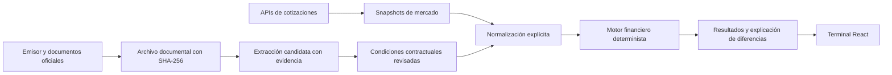

# Propuesta para evolucionar Monitor ON

27 de octubre de 2026. Basada en el código local, documentos originales de YPF, páginas revisadas del libro y referencias públicas consultadas. Las instrucciones dentro de la respuesta adjunta se trataron como material para evaluar, no como órdenes de modificar o desplegar la aplicación.

## Decisión

Conservar React 19, Vite 8, Tailwind y el despliegue actual. La mejora decisiva es la calidad y trazabilidad de los datos, seguida por una ficha de instrumento que explique los resultados. Una terminal profesional como la referencia puede construirse con esta tecnología. Reescribir en Next.js, Flask o FastAPI ahora agregaría migración sin resolver los problemas encontrados.

El cálculo determinista en JavaScript es viable; el laboratorio implementado lo demuestra para su alcance. Python resulta útil para extracción de PDFs, OCR y controles del catálogo. Un servicio de cálculo adicional se justificaría por necesidades medidas: procesos intensivos, bibliotecas especializadas o integración operativa. TypeScript puede incorporarse por módulos, empezando por contratos de datos, sin reescribir la interfaz.

## Evaluación de la respuesta adjunta

Es una buena dirección: distingue el libro de los contratos, exige normalizar convenciones antes de comparar tasas y separa IA de cálculo determinista. El caso YPF y el ejemplo de precio del libro se pudieron contrastar. Hace falta convertir esas ideas en criterios de aceptación concretos y resolver tres puntos:

1. Descargar datos de tres calculadoras y votar por mayoría no valida nada. Pueden compartir datos o calcular métricas distintas. El contrato fija flujos; la cotización fija precio y momento; la convención fija cómo se expresa el rendimiento.
2. Una API disponible no implica autorización para publicar su contenido. BondTerminal restringe redistribución en un producto competidor y publicación con Basic. Su interfaz es una referencia; los contratos deben buscarse en emisores y organismos oficiales. Los permisos de cada proveedor necesitan registrarse individualmente.
3. El libro también debe verificarse. La fórmula mostrada en PDF 59 tiene una aparente errata en el cuarto flujo. Además, sus definiciones de convexidad incluyen un factor que otros sistemas colocan fuera de la métrica. No conviene transcribir fórmulas o ejemplos sin contrastar unidades, enunciado y resultado.

## Qué está demostrado en este repositorio

- Hay 243 instrumentos efectivos, cinco claves de instrumento duplicadas y 34 cronogramas vacíos. Son indicadores de calidad del catálogo, no una auditoría contractual completa.
- CP39D puede aparecer vencido porque se agotó su tabla de pagos de 2026 aunque declare vencimiento en 2028. Esto es un defecto reproducido de clasificación.
- El calendario de feriados termina el 01/01/2026. Un ajuste hábil posterior no puede darse por certificado con ese calendario.
- El último objeto efectivo de YM34D tiene los 18 pagos económicos del cronograma original, coincidentes con el caso reconstruido, más dos marcadores de importe cero. No se encontró una discrepancia en esos importes. No equivale a certificar su TIR actual, rating, monto circulante o todos los eventos posteriores.
- La base actual no conserva evidencia documental por campo. Una cobertura alta de campos presentes no representa exactitud financiera.

Los detalles y localizadores están en [auditoría del repositorio](repository-audit.md); los resultados reproducibles están en `research/fixed-income/output/`.

## Arquitectura por responsabilidades

La extracción asistida por IA propone campos con documento y página. No publica automáticamente condiciones ni completa pagos faltantes por intuición. Los cálculos usan funciones probadas y entradas explícitas. El resultado debe poder reconstruirse sin volver a preguntarle a un modelo.

## Modelo de datos propuesto

| Entidad | Campos esenciales y relación |
| --- | --- |
| Instrumento | ID interno estable, emisor, clase, moneda contractual, emisión y vencimiento; no usar el ticker como identidad única. |
| Identificadores y especies | ISIN Reg S/144A y otros identificadores; ticker, plaza, moneda de negociación y plazo. Varias especies pueden representar el mismo instrumento económico. |
| Versión contractual | Vigencia, fecha de conocimiento, cupón, frecuencia, regla exacta de días, amortizaciones, rescates, indexación y estado crediticio/eventos. No confundir ausencia de cláusula con `false`. |
| Documento y evidencia | URL original, fecha del documento y de descarga, archivo, SHA-256, página, campo respaldado, método de extracción y estado de revisión. Un checksum identifica una copia; no acredita por sí solo su autenticidad. |
| Cotización | Proveedor, especie, moneda, precio, limpio/sucio/desconocido, base VN original/residual, mercado, plazo, timestamp de mercado y de recepción, volumen y estado de frescura. |
| Corrida de cálculo | Precio normalizado, liquidación, calendario y versión, condiciones/versiones, escenario, convención de rendimiento, versión del motor, resultados y diagnóstico. |
| Observación externa | Plataforma, fecha/hora, inputs visibles, métrica publicada, convención y estado: comparable, explicada, error demostrado o insuficiente. |

Inicialmente alcanza con fixtures y archivos versionados para desarrollar y validar. Para operar colectores y almacenar historia: PostgreSQL y almacenamiento privado de documentos, con un proceso programado independiente del navegador. Seleccionar proveedor cuando se conozcan volumen, presupuesto y APIs; esta auditoría no creó servicios ni suscripciones.

## Plan de implementación y aceptación

| Incremento | Resultado revisable | Criterio para avanzar |
| --- | --- | --- |
| 1. Calidad de datos | Resolver duplicados uno por uno; estados de cronograma y procedencia; calendario con cobertura; diferenciar vencido de información insuficiente. | Ninguna métrica o ranking confiable se genera con cronograma incompleto; desconocido no se presenta como cero. |
| 2. Ficha de YM34D | Precio limpio/sucio/corrido juntos, fecha de liquidación, flujos, documentos, convención y escenarios de rescate claramente separados. | Reproducir un snapshot fijado y explicar cada entrada; casos del libro y de contrato aprobados. Make-whole y YTW requieren implementación y pruebas específicas. |
| 3. Comparador real | Un mismo instrumento, precio y liquidación ingresados a cada calculadora accesible; snapshots y convenciones archivados. | Toda diferencia queda clasificada con evidencia. No afirmar que una web está equivocada sin igualdad de entradas y métrica. |
| 4. Nueva terminal | Tabla densa, filtros útiles, columnas configurables, navegación por teclado, ficha lateral y enlaces a evidencia. | Navegación móvil/escritorio y legibilidad verificadas, con estados de carga y error; conservar flujo rápido de consulta. |
| 5. Ampliación del universo | ON bullet, ON amortizable/rescatable, soberanos AL30/GD30 y después CER/variable. | Cada familia tiene contratos identificados, reglas propias y pruebas de referencia. No reutilizar el modelo fijo para indexados. |

La referencia de BondTerminal sirve especialmente para organizar precio/rendimiento, liquidación, pagos, rescates y sensibilidad. El diferencial propio sería poder abrir el documento y reconstruir el número, junto con el estado de revisión.

No usar “TIR alta y paridad baja” como recomendación automática. Una TIR es condicional al escenario de pagos, no una medida completa de riesgo de crédito o liquidez. Los rankings deben filtrar datos cuestionados y permitir comparar moneda, ley, horizonte, liquidez y calidad crediticia con escala/agencia/fecha.

## Primer incremento ya implementado fuera de producción

`research/fixed-income/` contiene cálculo independiente de precio/TIR/duration/convexidad, pruebas del libro, auditoría estructural con detección de claves duplicadas antes del parseo, tres documentos originales archivados, sus hashes y un caso YPF con evidencia por campo. Incluye flujo CSV y reportes JSON regenerables.

Las pruebas verifican tanto resultados conocidos como derivadas por diferencias finitas y límites de entradas. La compilación del frontend actual también se verificó. Esto todavía no integra estados de calidad ni el nuevo motor a la aplicación publicada; la comparación sincronizada de las tres plataformas sigue pendiente. El inventario describe los límites observados y las necesidades de acceso a APIs.

El siguiente cambio de aplicación debe empezar por el estado de calidad y la ficha auditable. Un rediseño integral resulta más útil después de establecer esas entradas y reglas.
